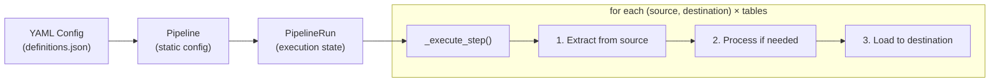

# Hermes Architecture Overview

Hermes follows a **plugin-based Extract-Load (EL)** architecture. There is no transform step — data flows from sources to destinations either as raw data or with minimal connector-level processing.

## High-Level Data Flow

## Plugin System

Connectors are discovered at runtime via **Python entry points** under the groups:

| Entry Point Group               | Purpose             |
|---------------------------------|----------------------|
| `hermes_plugins.sources`        | Source connectors     |
| `hermes_plugins.destinations`   | Destination connectors|

Each plugin is an independent Python package in `plugins/` with its own `pyproject.toml`, installed as an editable dependency.

## Configuration Model

Hermes uses a three-folder project structure resolved from environment variables or a `hermes_config.yml` file:

| Folder                   | Env Variable                      | Contents                        |
|--------------------------|-----------------------------------|---------------------------------|
| Configuration folder     | `HERMES_CONFIG_FOLDER`            | Pipeline YAML definitions       |
| Artifacts folder         | `HERMES_ARTIFACTS_FOLDER`         | `definitions.json` files        |
| Custom connectors folder | `HERMES_CUSTOM_CONNECTORS_FOLDER` | User-defined Python extractors  |

Pipeline definitions are loaded via [OmegaConf](https://omegaconf.readthedocs.io/) and define **sources**, **destinations**, and **pipelines** that connect them.

## Key Design Decisions

- **Separation of Pipeline and PipelineRun** — `Pipeline` holds static configuration; `PipelineRun` manages execution state (successes/errors) for a single invocation.
- **Cron-based windowing** — Each run computes a time window from the pipeline's cron schedule via `croniter`.
- **Cartesian execution** — A pipeline run iterates over the Cartesian product of `(sources × destinations)`, executing each table independently.
- **Structured error collection** — Errors are collected per-step rather than failing the entire pipeline, enabling partial-success runs.

## Module Map

| Module               | Role                                          |
|----------------------|-----------------------------------------------|
| `hermes/main.py`     | Entry point: `run_pipeline(name)`             |
| `hermes/pipeline.py` | Pipeline + PipelineRun classes                |
| `hermes/connectors.py` | Entry-point-based connector loader          |
| `hermes/settings.py` | Path resolution, constants, enums             |
| `hermes/exceptions.py` | Error hierarchy                             |
| `hermes/utils.py`    | Definition file loading                       |
| `hermes/logging_utils.py` | Logger factory                           |
